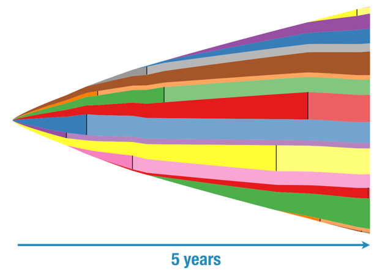

Because of past historical decisions and past structural changes, software development efforts on large, long-lived systems create architectures that rarely reflect today's organisation structure because temporal memory anchors past decisions, and engineers' turnover.

---

> the state of a system reflects [...] the organisational history and the flow of people through those organisations over the long term.
>
> -- Rob Smallshire, [Predictive Models of Development Teams and the Systems They Build](https://sixty-north.com/blog/predictive-models-of-development-teams-and-the-systems-they-build)), 2014

The reorganisation of people happens more frequently than the reorganisation or redesign of systems. Thus, the state of the system does not necessarily reflect the organisation. However, it does reflect the past historical decisions and the flow of people through the organisation.

## Half-Life

To understand this, we have to explain **Software Engineer Half-Life** and its effect on turnover and codebases over time.

> ... the turnover of developers can be modelled as if developers have a half-life within organizations [or a codebase].
>
> — Rob Smallshire, Predictive Models of Development Teams and the Systems They Build, 2014

Software Engineer Half-Life is the residency time of an engineer on a codebase, i.e. the amount of time they spend on a codebase before moving on. It seems that the industry average is 3.2 years. On average, we spend 3.2 years on a codebase, and then we move on.

This means that when we have a team of 10 engineers, half of the team will have left the team over the next 3.2 years. If we want to keep the team size constant, we need to replace them. But there is no guarantee that their replacement will have the same level of productivity.

A low-productivity engineer might be replaced with a higher-productivity engineer or vice versa. For small teams, this can significantly shift the overall productivity.

Not all engineers are equally productive. Even the same engineer will not exhibit the same productivity across different codebases, depending on codebase sizes and cognitive load. Adding 100 lines of code to a 1000-line codebase is a different thing from adding to a million-line system.

Generally speaking, a team's productivity goes down as codebase size increases.

To visualise the effect of this *Software Engineer Half-Life* on turnover and codebases, consider a turnover simulation on a team of seven engineers working on a codebase over five years.

<i>Source: <a href="https://sixty-north.com/blog/predictive-models-of-development-teams-and-the-systems-they-build">Predictive Models of Development Teams and the Systems They Build</a></i>
 

In this simulation, productivity is measured using lines of code. I know that is an outrageous way of measuring productivity. Of course, value creation and return on investment are way better metrics. But here is the thing. It is difficult to tie back to individual engineers. Therefore, we will stick with lines of code, knowing that it is a bad thing and we should not do this in real life. Promised?!?

Every day, there is a fixed probability that an engineer leaves and is replaced by another whose productivity varies randomly.

In the picture, time goes from left to right. On the left, we start with a team of seven with zero code. From top to bottom, we see different colours representing the code contributions of the different team members. The codebase grows quickly at first, but soon slows down.

At about 180 days, the purple engineer leaves, indicated by a black vertical bar. Their contributions remain static and are shown in a lighter shade. Because what they contributed stays in the codebase even when leaving the organisation.

A new engineer starts, coloured pink, who replaces purple. As we can see, they are way more productive than their predecessor. But they only stay for 200 days.

At the end of the five years, we find our team of seven has churned through ...

... a grand total of 19 engineers!!

The **majority of the surviving code was written by people no longer with the organisation**; only 37% of the code was written by people still present at the end of the five years. 63% of the code was written by engineers that long left the organisation.

## Temporal Memory

Conway's Law is not static. The structure of the software reflects the organisational structure integrated over time. This brings a time component to the law.

> A large organization similarly, stretches across time and space. Conway’s Law ties the two. How we organize defines how we think collectively, and thus what we make collectively.
>
> -- Pieter Hintjens, [Sex in Title, and other Stories](http://hintjens.com/blog:73), 2013

Large software systems as we see them today are the fossilised footprints of past engineers, and past decisions.

As half-life churns, organisational knowledge shifts from explicit knowledge to institutionalised myth. When teams experience trauma — such as production outages, blame, wrong architecture decisions in big bang changes — they unconsciously establish social defence mechanisms over time. These defence systems serve to cope with, eliminate, and avoid emotions such as anxiety, guilt, doubt, uncertainty, distress, fear of failure, blame or wrong decisions (Menzies, 1960; also Lawlor, 2019; and Bion, 1961).

- Ritual task-performance: Replacing personal discretion with rigid playbooks or compliance checklists to avoid individual decision-making responsibility.
- Reducing the weight of decision-making by checks and counter-checks: Multiplying approvals via multi-reviewer Pull Request gates, quality gates, and Change Approval Boards to distribute responsibility over committees; not only in cases of high-stakes, but also for situations with the slightest consequences.
- Reducing the impact of responsibility by upward delegation: Throwing decisions up the leadership chain to avoid blame, which in turn causes the organisation to choke on the high volume of upward exceptions (Galbraith, 1973, 1977).
- Avoidance for change: Any change involves a change in the social defence system; anxiety will in that case be more open and intense. Change is only instituted in moments of crisis.

Over time, these defence mechanisms become elements of culture and mode of functioning of the organisation. It becomes an aspect of the external reality for old and new staff members, and part of the myth, "*We have always done it like this*" (Menzies, 1960).

Much like software and IT systems, organisational culture and rules defined by social defence mechanisms carry on long after the original instigators have left. New staff members are socialised into these basic assumptions before they understand the system. The culture persists because it serves a protective psychological function, not an engineering one.

Both the system and the organisation possess a temporal memory, keeping each other eventually in balance, to anchor past decisions. Process debt and technical debt behave like dual manifestations of the same temporal memory.

## Archaeological Research on Enterprise Decisions

Hence, system architecture is a great source for archaeological research on past enterprise decisions.

> You can read the history of an enterprise's political struggles in its system architecture.
>
> -- Michael Nygard (@mtnygard), Twitter, May 8, 2013
>
> @mtnygard A history of Conway's Law
>
> -- Steve Smith (@SteveSmith_Tech), Twitter, May 8, 2013
>
> @mtnygard That's some sort of corollary to Conway's Law.
>
> -- @jmbroad, Twitter, May 8, 2013
>
> @jmbroad Definitely! It is the effect of changes in structure over time. (Credit goes to @mfeathers for the original thought there.)
>
> -- Michael Nygard, (@mntnygard), Twitter, May 8, 2013
>
> @mtnygard @mfeathers Unsurprising. I esteem you both as masters of software sociology. I recommend Arch w/o End State to everyone I know. :)
>
> -- @jmbroad, Twitter, May 8, 2013

Changes that we are starting now will coexist with changes that started last year and the year before. If we adopt that perspective, we stop trying to rip apart systems and start all over again. Instead, we should focus a lot more on incremental change (Nygard, 2012). Here begins our history of decisions, and how this history is embedded in our system's design as a result of the effects of structural changes over time.

At one conference, I was asked to provide an example of the code reflecting past enterprise decisions. Here are two:

- One FinTech had a Document Vault feature, basically the ability to securely store legal documents. Yet, customers and the Product Manager referred to the feature as Document Manager or File Manager, and eventually settled on File Manager. Ultimately, this got renamed over time in the code. However, for years, there was still this single directory, part of the infrastructure code, called `document_vault`, revealing the history of that feature.

- When another startup decided to opt for AWS as a cloud provider, they created all environments in a single AWS account against AWS's advice. From my experience screening tech organisations during technology due diligence, this seems to be a classic mistake, even within big corporations. Obviously, to segregate environments, all infrastructure resources were named with environment prefixes (or suffixes ... or even infixes ... consistency is an option). Eventually, they migrated to a multi-account setup; however, without taking the time to change the naming. Now they have, in every account, infrastructure resources unnecessarily named after the environment. Another story of system's design history embedded in the code to tell new team members during onboarding.

## Conclusion

Whenever we release our product, we ship our organisation — complete with its structure, its history, its past historical decisions and compromises, and the legacy of every engineer who has passed through its doors.

> Your org structure isn’t solving your problem.
>
> It’s an artifact of how you’ve solved it before.
>
> -- Adam Jacob (we assume the one from Chef 🤷), cited by Dan Slimmon, [Conway’s Law: The DevOps Skeleton](https://www.slideshare.net/danslimmon/conways-law-the-skeleton-of-devops)

> you always ship your organization, so design your organization well
>
> -- Michael Feathers at CraftConf 2014

## The Series: Navigating the Shades

[Beyond the Shades of Conway's Law series]():

- [Foundations: The Origin & The Mirroring Principle]() - How the worlds of organisation and product design observed the same thesis independently.
- [Validation: The Research & Reality Check]() - Moving beyond the "hunch", how researchers proved the Law in different industries, but especially in software.
- [Mechanics: The Mathematical & Geometrical Shades]() - The geometry of design: from mathematical isomorphism, homomorphism, congruence to compatibility.
- [Strategy: Reversing the Law]() - How the system ultimately forces the organisation to change versus deliberately changing the organisation.
- [Scale: Conway's Corollary]() - The required organisational flexibility.
- **Dynamics: Conway's Time Component** - The "Engineer Half-Life" and why architecture is "sticky" long after teams change.
- Conclusion: The Different Lenses - A concluding look at how we perceive organisations and their systems.

## Bibliography

- [A Case-Study in the Functioning of Social Systems as a Defence Against Anxiety](https://journals.sagepub.com/doi/10.1177/001872676001300201), Isabel E. P. Menzies, 1960
- [Experiences in Groups and Other Papers](https://app.thestorygraph.com/books/00a599d7-49d1-4b35-9d19-a67652910ed2), Wilfred R. Bion, 1961
- [How Do Committees Invent?](https://www.melconway.com/Home/Committees_Paper.html), Melvin Conway, 1968
- [Designing Complex Organisations](https://app.thestorygraph.com/books/c746ca36-a5d7-4c2a-995c-6330c4d363bd), Jay R. Galbraith, 1973
- [Organisation Design](https://app.thestorygraph.com/books/6b226d10-9cb0-41a2-89fa-bab1f81ee5d1), Jay R. Galbraith, 1977
- [Architecture without an end state](https://www.oreilly.com/content/michael-nygard-on-architecture-without-an-end-state/), Michael Nygard, 2012
- [Sex in Title, and Other Stories](http://hintjens.com/blog:73), Pieter Hintjens, 2013
- [Conway’s Law: The DevOps Skeleton](https://www.slideshare.net/danslimmon/conways-law-the-skeleton-of-devops), Dan Slimmon, 2014
- [Predictive Models of Development Teams and the Systems They Build](https://sixty-north.com/blog/predictive-models-of-development-teams-and-the-systems-they-build), Rob Smallshire, 2014
- [Test of Time - A Case-Study in the Functioning of Social Systems as a Defence Against Anxiety](https://www.researchgate.net/publication/330926688_Test_of_Time_A_Case), David Lawlor, 2019
