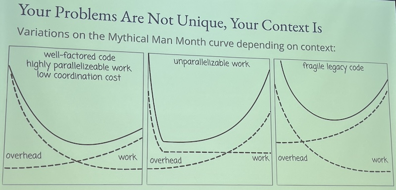
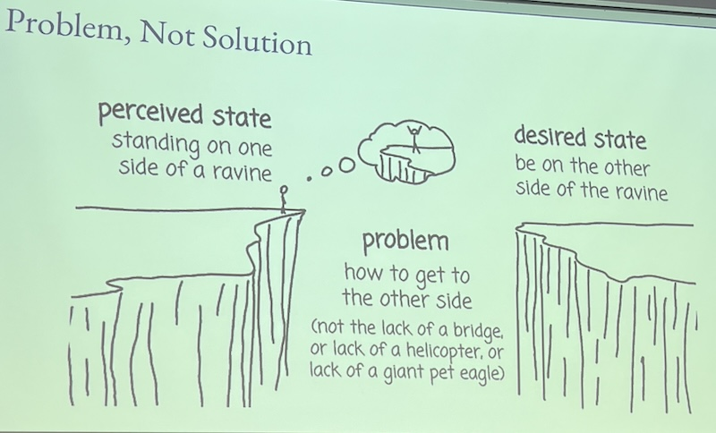

Best intentions go astray because software development organizations are non-linear adaptive systems. They can’t be controlled directly, but you can influence the system. We show you how.

Have you ever seen an attempt at process improvement backfire? If so, you’re not alone. Back in 2001 Elisabeth wrote about a case where better testing led to worse quality but that example is hardly unique. Examples abound. An organization trying to tighten up release timelines ended up with ever-increasing planning horizons. Yet another organization that rolled AI tooling to speed up development ended up slowing down. Best intentions go astray because software development organizations are non-linear adaptive systems. Attempting to control outcomes as a straightforward chain of cause and effect doesn’t work. When you face a big challenge—poor quality releases, slow delivery, or missed commitments—there is no single dial to turn. You can influence the system, but first you have to understand how it works. In this talk we show you how to see your context as a system, and reason about it so you can find the possibly counter-intuitive approaches to solve hard problems.

---

Book: [Signals & Levers, systems thinking tools to unblock for delivering systems](https://app.thestorygraph.com/books/9e6e44cf-65c6-4f95-88ba-0206a867c13f)

about systems thinking

Paper: [Better Testing Worse Quality](https://www.researchgate.net/publication/2415090_Better_Testing_-_Worse_Quality), Elizabeth Hendrickson

we were finding more bugs, most of the bugs were noise, not signals

they poked the system and the system poked back

## About Systems

A **system** is a set of interrelated parts that does something

it has these properties:

- the whole is indivisible
- parts are interdependent - when we change one part the others adapt, ripple effects
- systems are fractal - the way the team interacts is a function of the system

investment in automation - relentless prioritisation - fast feedback - team autonomy

**Levers** are choices or decisions you can make to cause a shift in the system

**Signals** are observable characteristics or attributes of the system that tell you something about the way the system works

## Why did that happen?

### differing perspectives

when someone pulls a lever they react on the signals they get, but not everybody sees the same signals

Sales: revenue - daily active users - competitor rankings - customer churn

Testers: bug counts - pull requests - cycle time - dependencies - test coverage

Operations: incident count - incident duration - deploy frequency - mean time to recover

all the signals effect each other

```plain
customer churn
     |
  revenue
     |
  pressure
     |             |
  tech debt    bug counts
     |
  incident count & duration
     |
  customer churn
```

=> adaptive systems

acting where pain is caused -> not where it is observed, the cause is something else

### levers operate in context

past choices determine current options
context is the aggregated result of past decisions

your problems are not unique, your context is

variations on the Mythical Man-Month curve depending on context



- well-factored code, highly parallelisable work, low coordination cost
- unparallelisable work
- fragile legacy code

Understand Context in Concrete Teams
dimensions of context

- capacity: 1 full time member, 3 split
- risk: few tests, fragile code
- execution
- adaptibility: informal process
- trust: high blame, political
- economics: budget pressure

mixing contexts: capacity vs execution, need more people to go faster is an execution problem, not a capacity problem

context changes constantly

### solving the wrong problem

when having an execution problem and trying to solve it with capacity will make it worse

**flying buttress** is a process or policy designed to shore up another process or policy that can't hold on its own

examples:

- pre- pre- meetings to prepare the meeting
- a formal expediting process to bypass process overhead
- overstandardisation

problem, not solution

perceived state: standing on one side of a ravine

problem: how to get to the other side (not the lack of a bridge, or lack of a helicopter, or lack of a giant pet eagle)

desired state: be on the other side of the ravine



we don't have enough tests is not the problem

## Now What?

first understand the levers in context

testers already do systems thinking, they ask the right questions, holistic view

policy & culture levers

when policies are at odds, culture wins

culture: the unwritten stuff, the unwritten norms of behaviour

the signals, the rituals are expressions of culture

regardless of title, we have levers, we can share the signals we observe

ex. meeting, it seems we already have this conversation before, why? maybe something else is happening
