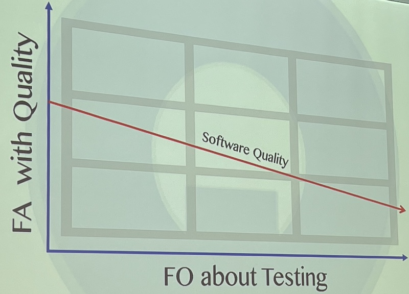
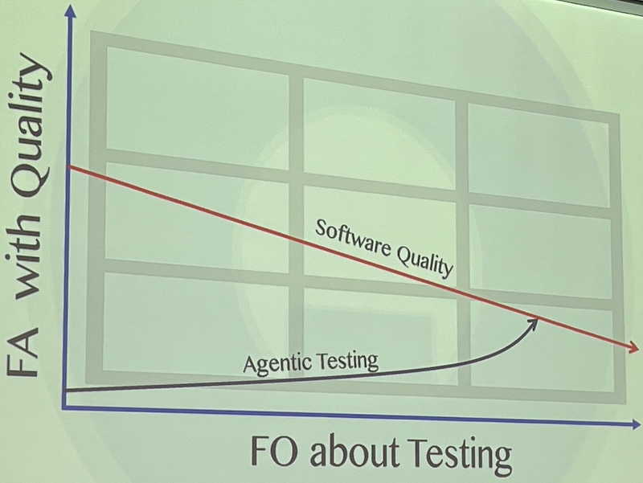
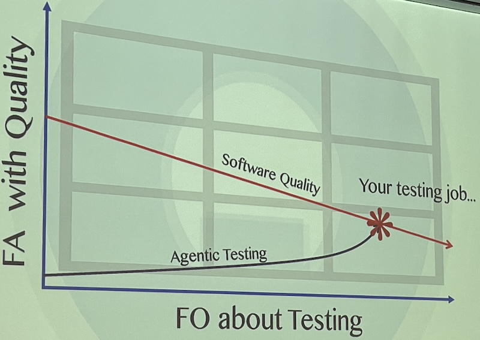
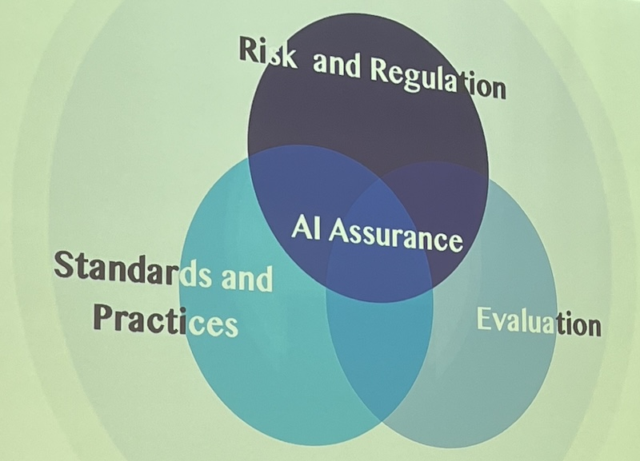

AI won’t liberate us from testing, it will expose the weaknesses in how we measure, govern, and understand quality. The real risk isn’t AI. It’s how we choose to use it.

How the promise of AI-powered testing is creating new risks, old mistakes, and a massive opportunity for testing to reclaim its strategic value.
For years, the testing industry has chased “liberation” through fewer humans, more automation, and faster delivery. AI in testing is simply the latest version of that empty promise by an industry seemingly intent on destroying its value proposition.

Through this keynote I’ll make the case that AI doesn’t eliminate the need for testing (or testers), it magnifies the consequences of weak testing strategy and tool fetish as policy.

I’ll lay out what I think matters when AI enters the stack: how we validate non-deterministic behaviour, how we avoid automation slop, how we keep human judgement in the right places (and admit its limits), and how we build evidence that stands up to regulators, auditors, and reality.

The “Great Liberation” isn’t freedom from testers; it’s freedom from bullshit.

---

"*We have to be careful about what we pretend to be*"

> If the rise of an all-powerful artifical intelligence is inevitable, well it stands to reason that when they take power, our digital overlords will punish those of us who did not help them get there.
>
> Ergo, I would like to be a helpful idiot. Like yourself.
>
> -- Bertram Gilfoyle 

There is no such thing as ethical AI
AI does not have ethics, people do
AI does not have a believe system, people do

AI was build on stolen data and by exploitation of people

all the discussion about bias, ethics, ... takes us away from the real problem
there is real harm being done and moral harsh by the people that are building AI

people do this, not machines

some intractable problems with testing AI

## Intractable AI Testing Problems

### alignment is soo hard

They suck: models are horrible at alignment

UK AI Security Institute tested the latest OpenAI model:
30% of the time, OpenAI latest model was doing things it was not supposed to do

We suck:

warfare simulation: every single model, identified surrendering soldiers, ambulances, civilians, schools as acceptable targets

where do you think those models get their ideas, you

You suck too

AI cannot trenscend humanity because it was build by humanity

"*I don't want AI to get in the hands of the wrong people*"

it is already in the hands of the wrong people

### verification asymmetry

there has always been asymmetry in testing;
the speed, the scale, the self-healing, impossible to verify

let's use different LLM agents to verify, but here is the thing, LLMs show bias towards other LLMs, they also do not like humans

we have to have a human in the loop (HITL)

### HITL

Movie: The Big Short: when trying to explain mortgage backed securities -> if AI is dark-shit, then HITL is dark-shit in cat-shit

the gap in understanding HITL between tech, general public and governments is massive

justified trust: your claims about the verifications needs to be verified too

EU AI Act: people need to check everything that comes out of AI;
can you verify every single line of code generated by an agent?
most quoted and least enforced regulation

you are probably building a preference for any AI response because it makes you feel smart

## The Great Capitulation

### The Enshittification of Testing

**Enshittification**

introduced by [Cory Doctor](https://mamot.fr/@pluralistic):

- get people to use your platform, make it actually good
- then exploit the shit out of it, make the platform crappy and hard to leave
- then exploit the shit out of the business

how does that look for testing

- make tools to help testers do their work
- testing is continuously redefined downwards only to what a tool can do and management can count
- vendors promising you need fewer testers while keeping quality

quality is going down, and it is getting worse

annual cost of software failures 1,8 trillion dollars just in the US; and an equal amount of software projects that have been cancelled

quality has not getting better in 20 years

agentic testing is getting just a little better

in the meantime you have to compete with a machine

what happens when both lines meet

that is not possible, vendors tell us we need more humans

#### Tester-bot Nation

replace human testers with agents

Vendors:

> independently maps 200 test cases with zero testers in the loop

> we produce exactly whant product managers demand without any humans in the loop

> AI writes code, AI tests code, and human in the loop. 

but ...

> Agents testing agents before a release without humans in the lloop

the claims these vendors make do not work with the current workforce
the only way to justify the AI build out is by firing 50% of white collars

### Grifters, Cynics, and Nuts

Grifters

more tests = more testing; automate everything;
they probably never tested anything in their life

Cynics

never have to live with the consequences of testing decisions, they look at it like math

Nuts

testing is a deeply human experience; they cannot relate to it, they are true AI apologists

it is not that everybody in AI is lying, it is that we build a system that noboday gets rewarded for telling the truth

## Everything Old is New Again

### Testers do what?

journey of rediscovery of what testers have been struggling for decades

- systems thinking
- oh a person is involved in the system, so we need to make the system more usable

then we end up renaming and end up describing describing exactly what was done before

### OMG Testing is Hard!

what these people do not like:

- these people actively do not want to be called a tester, despite talking about it, going to conferences, they want to be called engineers
- the idea we need to write down everything
- testing vs checking

### Engineering Emotions

got to be the worst

we deal with clients, lying to clients is not a service

uncertainty is a feature, not a bug, we want to know the things we do not know, not the things we know

people can be extremely confident, and extremely incorrect

women doing all the hard work around AI safety and how to test these things

- [Emily Bender](https://dair-community.social/@emilymbender)
- [Timnit Gebru](https://dair-community.social/@timnitGebru)
- [Maaike Brinkhof](https://hachyderm.io/@maaikees)
- [Elizabeth Zagroba](https://chaos.social/@ez)
- [Angie Jones](https://bsky.app/profile/angiejones.tech)
- [Ashley Hunsberger](https://www.linkedin.com/in/ashleyhunsberger/)
- [Fiona Charles](https://www.linkedin.com/in/fionacharles/)
- [Anne-Marie Charrett](https://www.linkedin.com/in/testingtimes/)
- ...

## What can we do about this?

not much

AI Assurance

see this exceedingly through regulations, and audits

- Tech UK, driving a lot of regulation, not only how we test but also how to judge the claims and ty back to 
- EU NIS2 risk management framework
- South-Korean AI Basic Act

testers who know how to test can find their way through this: 
Context Driven Testing

> True Liberation acknowledges where we are, how we got here, and frees us from bullshit.

this is not normal, what is going on right now

to be in opposition is not annihilist

- I am not apposed to AI, but to bullshit
- I am apposed to abandoning responsibility
- I am apposed to vendors selling bullshit
